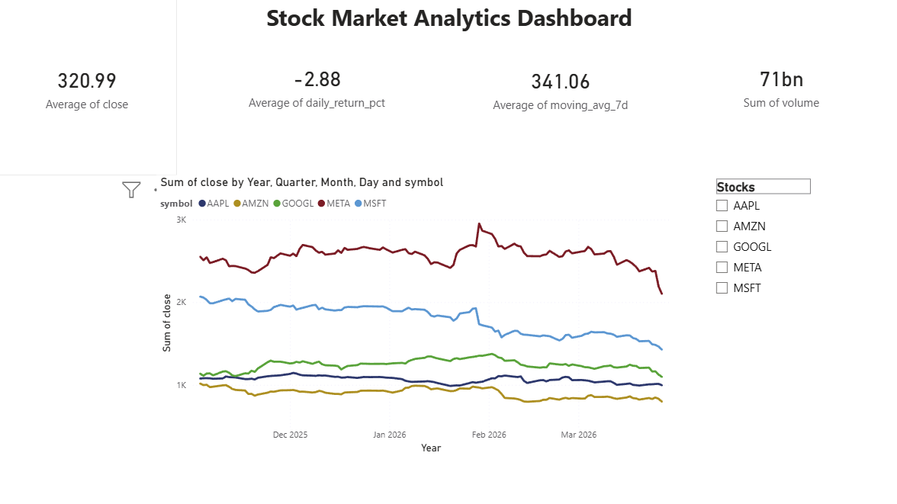
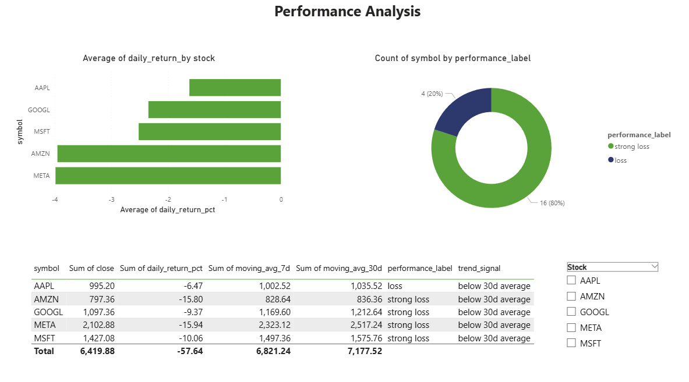
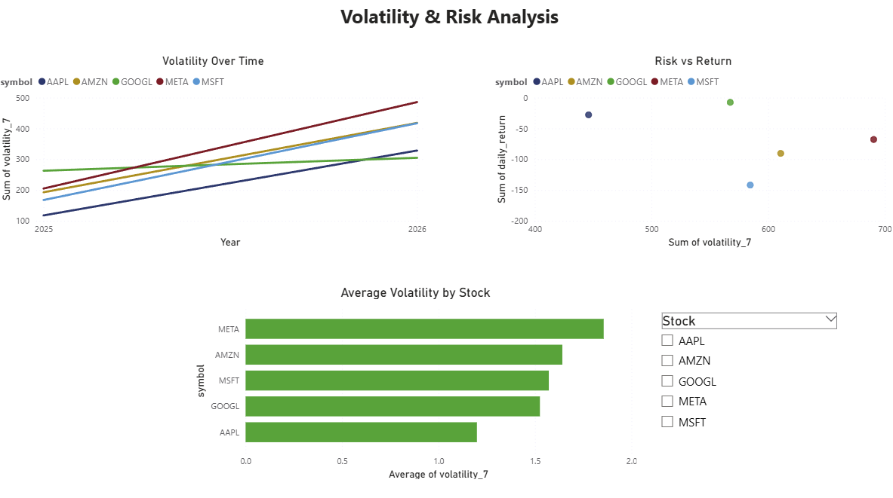

# Stock Market Data Pipeline

An end-to-end data engineering project that runs locally: scheduled
ingestion, a medallion (Bronze/Silver/Gold) lakehouse, Delta Lake, dbt models
on DuckDB, Airflow orchestration in Docker, and Power BI dashboards.

## Architecture
```
Alpha Vantage API → Python ingestion (requests)
                                          ↓
                                    Bronze Layer (Raw JSON)
                                          ↓
                                    Silver Layer (Parquet)
                                          ↓
                                    Gold Layer (Aggregates)
                                          ↓
                                    Delta Lake (ACID)
                                          ↓
                              dbt Models → DuckDB → Power BI
```

## Tech Stack

| Layer | Technology |
|-------|-----------|
| Ingestion | Python, Alpha Vantage API |
| Storage | Local file system (`data/` folder) |
| File Format | JSON, Parquet, Delta Lake (`deltalake` / delta-rs) |
| Transformation | Python, Pandas |
| Modelling | dbt (data build tool) |
| Orchestration | Apache Airflow (Docker Compose) |
| Warehouse | DuckDB |
| Data Quality | Python validation checks, dbt tests |
| Query Interface | NL-to-SQL prototype (rule-based) |
| Visualisation | Power BI |

## Project Structure
```
stock-data-pipeline/
│
├── ingestion/              # Data ingestion scripts
│   ├── fetch_stock_data.py # Alpha Vantage API ingestion
│   └── nl_to_sql.py        # NL-to-SQL prototype (rule-based)
│
├── transformation/         # Data transformation scripts
│   ├── transform_stock_data.py  # Bronze to Silver
│   ├── build_gold_layer.py      # Silver to Gold
│   └── delta_lake.py            # Delta Lake conversion
│
├── stock_analytics/        # dbt project
│   ├── models/
│   │   ├── staging/        # Staging models + tests
│   │   └── marts/          # Business ready models
│   └── dbt_project.yml
│
├── orchestration/          # Airflow DAGs
│   └── stock_pipeline_dag.py
│
├── docker/                 # Docker configuration
│   └── Dockerfile
│
├── docker-compose.yml      # Airflow stack
├── requirements.txt        # Python dependencies
└── README.md
```

## Data Architecture

This project implements the **Medallion Architecture**:

- **Bronze Layer** — Raw JSON data exactly as received from Alpha Vantage API
- **Silver Layer** — Cleaned and validated Parquet files with engineered features
- **Gold Layer** — Business ready aggregates for dashboards and reporting
- **Delta Layer** — ACID compliant Delta Lake tables with time travel support

## Features

### 1. Automated Data Ingestion
Fetches daily stock data for AAPL, MSFT, GOOGL, AMZN and META from 
Alpha Vantage API with idempotent loading to prevent duplicates.

### 2. Data Transformation
- Calculates daily returns, 7/30 day moving averages and volatility
- Validates data quality before loading to Silver layer
- Builds business ready Gold layer aggregates

### 3. Delta Lake
- Converts Parquet files to Delta format with ACID transactions
- Supports time travel queries to audit historical data
- Upsert (MERGE) operations prevent data duplication

### 4. dbt Models
- Staging models clean and standardise raw data
- Mart models build business ready views with performance labels
- 7 automated data quality tests
- Auto generated documentation with data lineage

### 5. Apache Airflow Orchestration
- Full pipeline runs automatically at 6pm every weekday
- Three task DAG: ingest → transform → gold layer
- Containerised with Docker for reproducibility

### 6. NL-to-SQL Prototype
A natural language interface for querying stock data. The current version
maps question keywords to SQL templates (`generate_sql_mock` in
`ingestion/nl_to_sql.py`) and runs them against DuckDB. The next step is to
swap in an LLM that gets the schema in its prompt, with a read-only SQL check
before execution.
```
Question: Which stock had the highest closing price today?
Generated SQL: SELECT symbol, close FROM mart_daily_summary 
               ORDER BY close DESC LIMIT 1
Result: GOOGL  189.42
```

## How to Run

### Prerequisites
- Python 3.11+
- Docker Desktop
- Anaconda

### Setup
```bash
# Clone the repo
git clone https://github.com/Dinesh-0707/stock-data-pipeline.git
cd stock-data-pipeline

# Install dependencies
pip install -r requirements.txt

# Set up environment variables
cp .env.example .env
# Add your Alpha Vantage API key to .env

# Start Airflow
docker-compose up -d

# Run ingestion manually
python ingestion/fetch_stock_data.py

# Run transformation
python transformation/transform_stock_data.py
python transformation/build_gold_layer.py

# Run dbt models
conda run -n dbt-env dbt run --project-dir stock_analytics
conda run -n dbt-env dbt test --project-dir stock_analytics
```

## JD Requirements Coverage

This project was built to match real data engineer job requirements:

| Requirement | Implementation |
|-------------|---------------|
| Pipeline architecture | End-to-end medallion architecture |
| ETL/ELT pipelines | Python + dbt |
| Apache Airflow | Automated DAG scheduling |
| dbt | Staging and mart models, tests, docs |
| Delta Lake | ACID transactions, MERGE upserts, time travel |
| Data quality | Python validation + dbt tests |
| Warehouse / SQL | DuckDB |
| BI layer | Power BI dashboards |
| Containerisation | Docker + Docker Compose (Airflow) |

## Not Yet Implemented

These would be the next steps toward a cloud deployment and are **not** in
the current code:
- Cloud storage and warehouse (e.g. Azure Data Lake Storage, Synapse)
- Streaming ingestion (Kafka / Event Hubs)
- Spark processing for larger volumes
- An LLM-backed NL-to-SQL engine
- CI/CD (GitHub Actions)

## Author

**Dinesh** — MSc AI with Business, Aston University  
github.com/Dinesh-0707
## Dashboard Preview

### Overview Page


### Performance Analysis


### Volatility & Risk Analysis


